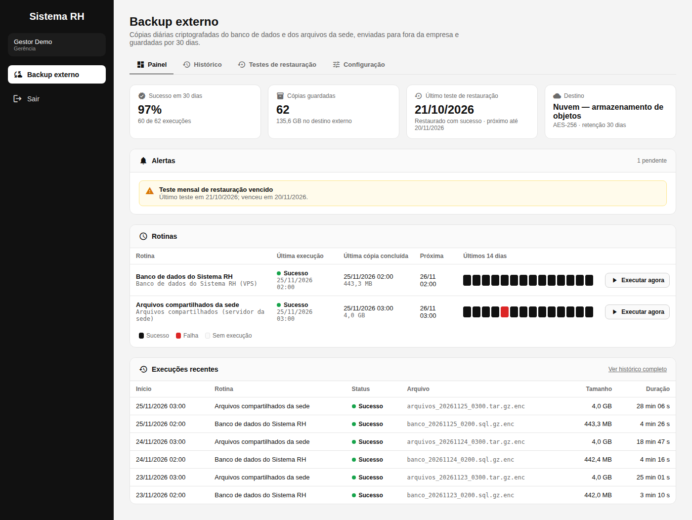
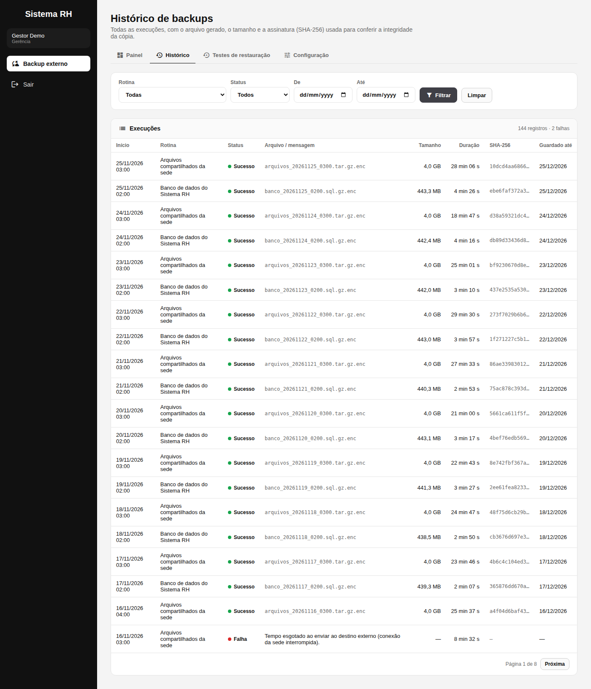
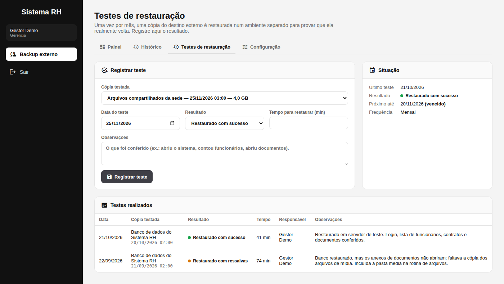
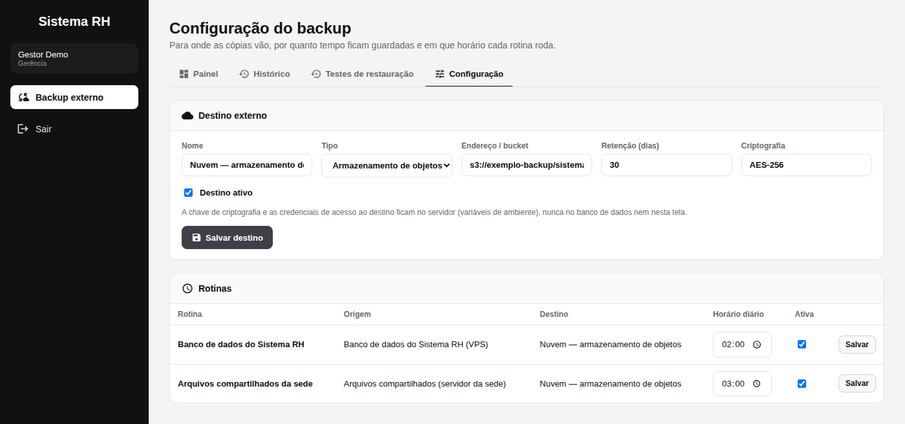
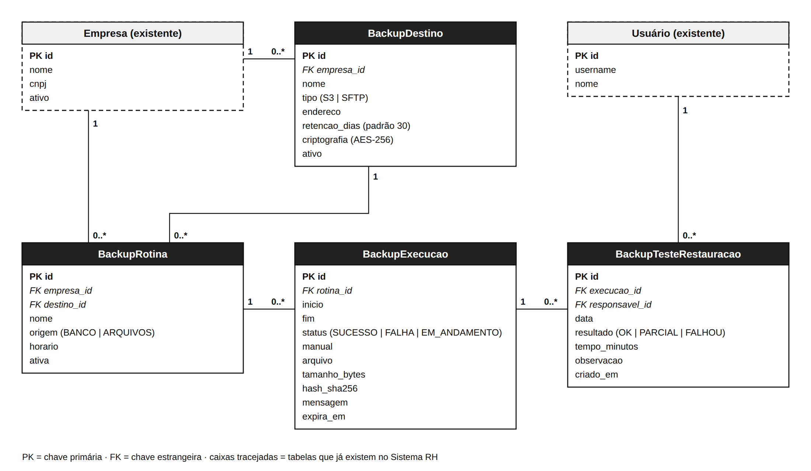

# Módulo de Backup Externo — protótipo

Protótipo de um módulo de **backup externo automatizado** para um sistema de RH web (Django), desenvolvido no
Projeto Interdisciplinar Prático e Extensão II (Engenharia de Software).

O diagnóstico de maturidade digital feito na etapa anterior, numa empresa parceira (anonimizada), mostrou que as
cópias de segurança do sistema ficavam só em HDs removíveis guardados na própria sede: sem cópia fora do local, sem
política de retenção e sem teste de restauração. Este módulo propõe:

- cópia diária do banco de dados e dos arquivos, **criptografada (AES-256)** e enviada para fora da sede;
- **retenção de 30 dias** e assinatura **SHA-256** de cada cópia;
- **painel** com indicadores, situação dos últimos 14 dias e **alertas** (falha, atraso, teste vencido);
- **histórico** de execuções com filtros;
- registro dos **testes mensais de restauração**.

> Os dados exibidos são **fictícios**. Neste protótipo a cópia em si (dump, criptografia e envio) é **simulada**:
> o histórico vem do comando `backup_demo` e o botão "Executar agora" registra uma execução simulada. O diagrama
> de atividades abaixo descreve como a rotina real funcionaria.

## Telas

| Painel | Histórico |
|---|---|
|  |  |

| Testes de restauração | Configuração |
|---|---|
|  |  |

## Modelagem

- [Casos de uso](docs/diagramas/d1_casos_de_uso.png)
- [Modelo de dados](docs/diagramas/d2_modelo_dados.png)
- [Atividades da rotina diária](docs/diagramas/d3_atividades.png)
- [Fluxo de navegação](docs/diagramas/d4_navegacao.png)



## Como rodar

Requer Python 3.10+.

```bash
python -m venv .venv
source .venv/bin/activate          # Windows: .venv\Scripts\activate
pip install -r requirements.txt
python manage.py migrate
python manage.py backup_demo       # cria a empresa de demonstração, o usuário "gestor" e o histórico fictício
python manage.py runserver
```

Acesse http://localhost:8000 e entre com o usuário `gestor` e a senha mostrada pelo `backup_demo`
(ou defina uma: `python manage.py backup_demo --senha minha-senha`).

Testes automatizados:

```bash
python manage.py test
```

## Estrutura

```
backup/
  models.py            Empresa e Perfil (mínimos, só para o protótipo rodar)
  models_backup.py     Destino, Rotina, Execução e Teste de restauração
  views.py             Painel, histórico, testes de restauração, configuração e alertas
  acesso.py            Regra de acesso: só o perfil Gerência
  templates/backup/    Telas
  management/commands/backup_demo.py   Dados fictícios de demonstração
  tests.py             12 testes (alertas, permissões, execução manual, formulários)
config/                Configuração Django (SQLite, somente desenvolvimento)
docs/                  Capturas de tela e diagramas
```

## Observações

- No sistema original o módulo roda dentro de uma aplicação maior, com autenticação em dois fatores;
  aqui foi extraído só o módulo, com login simples, para fins de demonstração.
- As configurações em `config/settings.py` são apenas para uso local.
